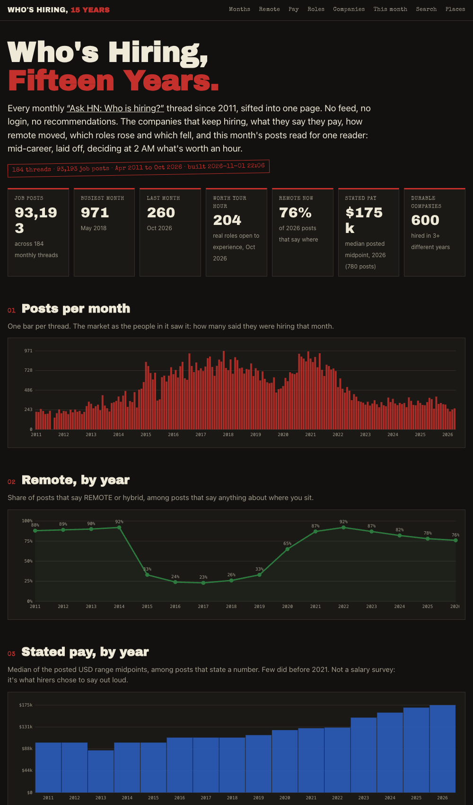
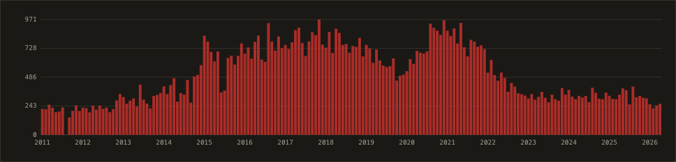
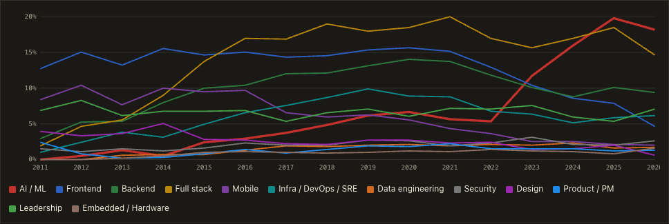
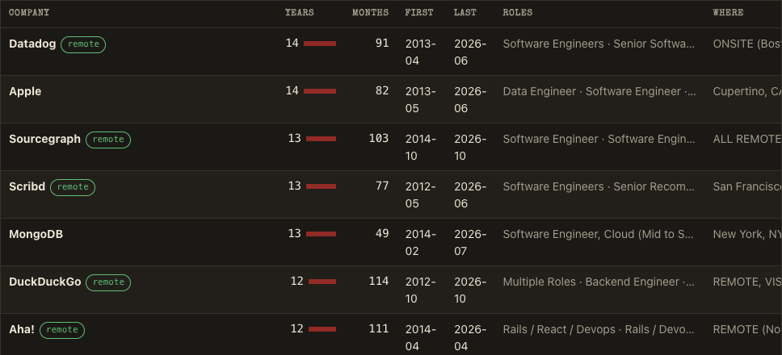
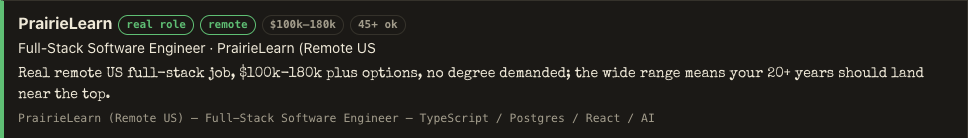

# Who's Hiring, 15 Years

Every monthly Hacker News **"Ask HN: Who is hiring?"** thread since April 2011, sifted into one static page for a mid-career reader who was just laid off and is deciding at 2 AM whether a post is worth an hour.

**Live: [whoshiring.app](https://whoshiring.app).** No feed, no login, no recommendations. Every number links back to its Hacker News post, so when something looks wrong the source is one click away.

<p align="center"></p>

## The bet

Built in one sitting on November 1, 2026 as **Bet №1** of [Joe Wilson Builds](https://aibuildersclub.ai).

| | |
|---|---|
| **CLAIM** | In one sitting, Claude turns fifteen years of HN hiring threads into a page a laid-off 45-year-old can actually use. |
| **CLOCK** | 9:12 PM start → page live 9:25 → every October post judged by 10:15. |
| **COST** | $0.85 in model calls, logged per call in `data/spend.jsonl`. Plus a $10.19 domain. |
| **VERDICT** | Confirmed on the six goals below. Whether it beats a job board at 2 AM is yours to call. |

Six goals, miss one and it's busted:

1. Every thread since 2011, every post, no sampling.
2. The trends: posts, remote, pay, roles.
3. The companies that hire every single year.
4. Every post this month, read and judged for that reader.
5. Every number one click from its source.
6. Under $5 in AI, finished before bed.

## What the page shows

The figures below are from the bet build: 184 threads and 93,193 posts, April 2011 to October 2026, the same data that is in this repo. The live page refreshes monthly, so its counts run ahead of this README.



- **Posts per month.** The peak was May 2018 (971). 2021 came close. 2026 averages under 300 posts a month, about where 2013 was, and the last four months are the lowest run since early 2013.
- **Remote by year.** From a quarter of posts in 2016 to 92% in 2022, slipping every year since to 76%.
- **Stated pay by year.** The posted median midpoint kept climbing while post counts fell: $150k in 2023, $175k in 2026. Fewer jobs, more senior, and they pay for it.
- **Roles over time.** AI/ML went from about 5% of role mentions in 2022 to nearly 20% in 2025, while frontend fell from 15% to under 5% and mobile from 10% to 2%.



- **The durable ones.** 600 companies that posted in three or more different years (Datadog and Apple 14 years each, then Sourcegraph, Scribd, MongoDB and DuckDuckGo), each with its latest post.



- **This month, judged.** Every post in the newest thread is labeled by a model: real role, junior only, needs PhD, contract, equity only, vague, recruiter, not a job. It also flags whether a 45+ candidate is plausibly wanted, whether coding is required, whether a degree is stated, seniority, and pay, with a one-line note. The page hides the noise by default and offers toggles for "45+ welcome", "no coding required", "pay stated" and "no degree required". October 2026: 206 real roles, 204 of them open to experience, 15 needing no code.



- **Search all fifteen years** (loaded only when you type) and **where the jobs were**, by year.

These are companies that chose to post on HN, so it skews to startups and remote-friendly engineering. It is a thermometer for that world, not for all of tech.

## How it's built

| File | Does |
|---|---|
| `fetch.py` | Algolia HN API → `data/raw/<thread>.json`. Skips threads already on disk; `--refresh` refetches the newest 3. |
| `parse.py` | Top-level posts → `data/jobs.jsonl`, read by the `Company \| Role \| Location \| REMOTE \| pay` convention, with a classifier for location, role and noise. A freeform fallback is flagged `conf=guess` and kept out of the durable list. |
| `score.py` | The judgment layer: `claude-sonnet-5-5` reads each post in the newest month and returns a label, flags and a note. Resumable per post; spend logged to `data/spend.jsonl`. |
| `build.py` | Aggregates → `site/data.json` (413 KB) and `site/index.json`, the search index (7 MB, loaded lazily). |
| `refresh.py` | The monthly run: fetch, judge, rebuild, ship. |
| `site/` | One static page, no framework. nginx config in `deploy/nginx.conf`. |

## Run it

Python 3 standard library only. `data/raw/` is not in the repo, so the first fetch pulls every thread from the free Algolia API, which took about five minutes here; parsing takes about as long again.

```bash
python3 fetch.py && python3 parse.py
ANTHROPIC_API_KEY=... python3 score.py          # judges the newest month; about $0.003 a post
python3 build.py
cd site && python3 -m http.server 8000           # or rsync site/ to any static host
```

Monthly: `WHOSHIRING_SSH=user@host ANTHROPIC_API_KEY=... python3 refresh.py` pulls the new thread, judges its posts, rebuilds and ships. It stops before shipping if the page would shrink or if under 90% of the newest month got judged, so a bad run leaves the live page alone.

Parsing is heuristic on purpose. The first line of a post is read by the convention HN posters follow; anything the parser only guessed at is flagged and excluded from the company list. Labels on this month's posts are a model's opinion, and the page says so. The data comes from a public API: no scraping beyond it, and no personal data beyond what posters published to a public thread.

## Credits

Data: the Hacker News API via Algolia, threads posted by [whoishiring](https://news.ycombinator.com/user?id=whoishiring). The shape of the project owes a debt to Andrej Karpathy's HackerTube: one public pile of human signal, a model does the sifting, a person does three clicks. Built by Joe Wilson with Claude, November 1, 2026.
